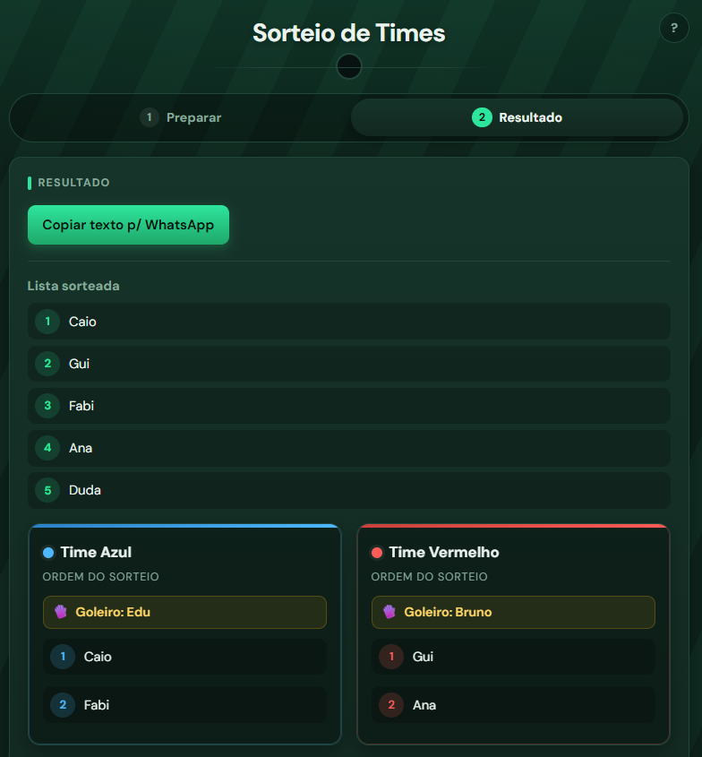

# sorteio-times

[](https://github.com/WallaksCardoso/sorteio-times/actions/workflows/ci.yml)

App para sortear os times da pelada no celular: <https://celadon-palmier-f76ac3.netlify.app/>



Duas vezes por semana alguém do grupo fechava a lista no WhatsApp e sorteava os times na mão, o que
demorava e sempre dava discussão. Aqui você cadastra quem vai jogar, marca os goleiros, sorteia e
copia o resultado já formatado para o grupo.

É uma PWA estática, sem servidor e sem login: instala na tela inicial e guarda a lista no próprio
aparelho. Esta é a versão que de fato uso; o [pelada-gestao](https://github.com/WallaksCardoso/pelada-gestao)
resolve o mesmo problema em microsserviços, como estudo.

## Como o sorteio funciona

Os jogadores de linha são embaralhados e distribuídos alternadamente entre Azul e Vermelho. Os
goleiros são sorteados à parte, um para cada time. Quem passa do número de titulares fica de reserva.
O app avisa quando há só um goleiro, goleiros demais ou gente de menos. Nomes repetidos são
reconhecidos mesmo com acento, maiúscula ou espaço diferente.

Os detalhes e as decisões estão em [`docs/`](docs/).

## Rodando

Node.js 20 ou mais novo:

```bash
npm install
npm run dev
npm test
```

`npm run build` gera a pasta `dist/`, que o Netlify publica a cada push (configuração em
`netlify.toml`).

## Licença

MIT
